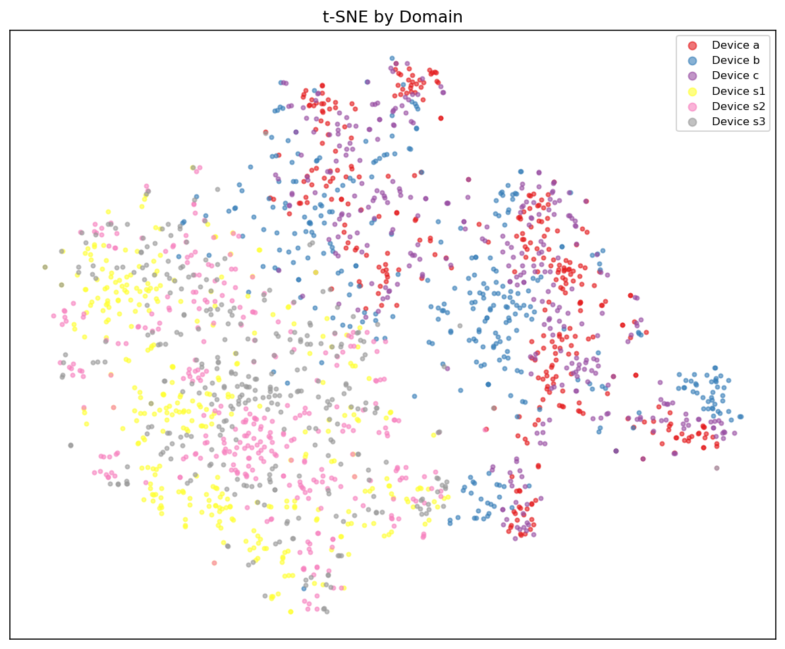
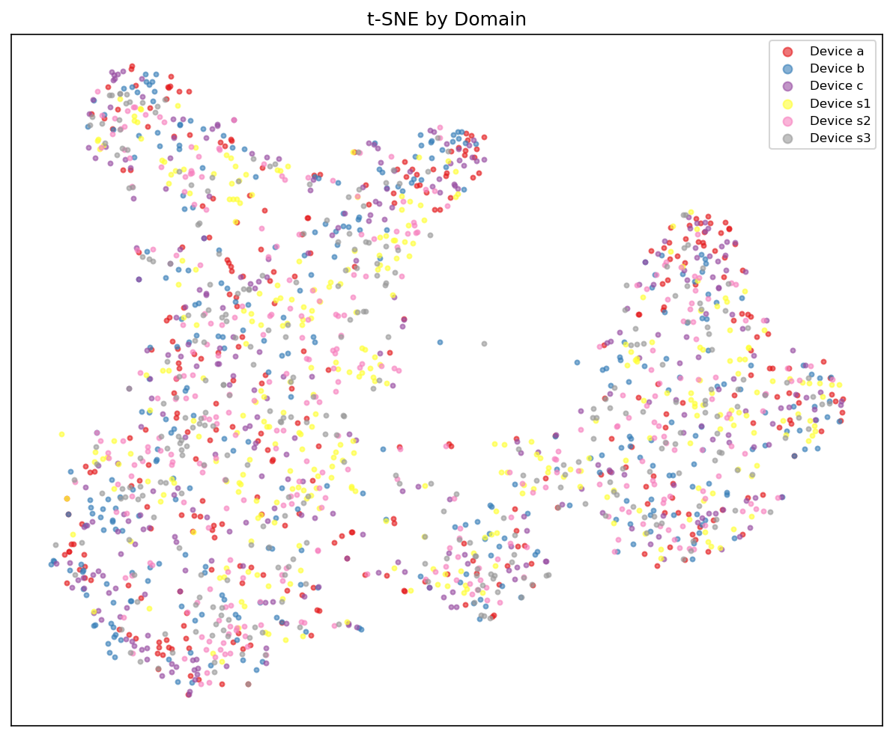

# Domain Adaptation for Acoustic Scene Classification (MFDWC vs PaSST)

**Keeping sound-recognition models accurate when the recording device changes.**

This repository contains our final-year B.Tech project at Rajagiri School of Engineering & Technology (RSET), funded by a **₹1 lakh MeitY IndiaAI Fellowship**. It builds on our research internship at IIT Mandi, where we applied unsupervised domain adaptation (UDA) to cross-device acoustic scene classification using the PaSST audio transformer.

A model trained on audio from one device loses accuracy when the same scenes are recorded on a different phone or recorder. Here we compare two feature extractors, the pretrained **PaSST** transformer and the lightweight, hand-engineered **MFDWC** (Mel-Frequency Discrete Wavelet Coefficients), each paired with two UDA methods, **Gradient Reversal Layer (GRL)** and **Cycle Self-Training (CST)**, on the DCASE TAU Urban Acoustic Scenes 2020 Mobile dataset. The question is how much accuracy each combination recovers on unseen devices, and what that accuracy costs in compute.

📄 *State-of-the-Art Domain Adaptation in Deep Learning for Acoustic Scene Classification*, ICTEST 2026 (IEEE Xplore)

## Team and Guidance

- **Ronn Mathew Sino** (Team Lead), **Amisha Angel Pius**, **Ashwin Rao K**, **Merin Antony**: Department of Computer Science and Business Systems, RSET
- **Guide:** Dr. Divya James, Associate Professor, Department of Computer Science and Business Systems, RSET
- **Mentor:** Abhishek Dileep, Research Scholar, School of Computing and Electrical Engineering, IIT Mandi

## Repository Structure

```
├── mfdwc_extractor_with_flag.py   # MFDWC feature extractor (60 mel bands, Haar DWT, WA ⊕ ΔA ⊕ WD)
├── models.py                      # CNN feature extractor, classifiers, domain discriminator, CST head
├── data.py                        # TAU 2020 Mobile splits by device, audio dataset and loaders
├── baseline.py                    # Source-only MFDWC + CNN, one target device
├── baseline_alldevice.py          # Source-only MFDWC + CNN, all target devices
├── grl.py                         # MFDWC + CNN with GRL (DANN), one target device
├── grl_alldevice.py               # MFDWC + CNN with GRL, all target devices combined
├── cst.py                         # MFDWC + CNN with Cycle Self-Training, one target device
├── cst_alldevice.py               # MFDWC + CNN with CST, all target devices combined
├── eval.py                        # Source and target accuracy for trained checkpoints
├── visualize.py                   # t-SNE, confusion matrices, per-class accuracy, training curves
├── training_timer.py              # Training-time logging
├── passt/
│   └── visualize_passt.py         # Matching evaluation and plots for the PaSST models
├── results/
│   ├── mfdwc-baseline/            # Checkpoints per device pair (a-b, a-c, a-s1, a-s2, a-s3) + CSV logs
│   ├── mfdwc-grl/                 # Checkpoints per device pair + CSV logs
│   ├── plots/                     # Plots and classification reports for every model
│   └── mfdwc_experiment_results.xlsx
├── archive/                       # Earlier versions, debugging scripts and the reference DCASE CNN code
├── envi.yml                       # Conda environment
└── LICENSE
```

## Project Overview

### Phase 1: Validation on Computer Vision (IIT Mandi internship)
We first re-implemented GRL and CST on the standard SVHN → MNIST digit benchmark, to validate the implementations before moving to audio.

| Method | Target accuracy (MNIST) |
| --- | --- |
| Source only, no adaptation | 63.1% |
| DANN with GRL | 72.1% |
| Cycle Self-Training | 92.7% |

### Phase 2: PaSST on Cross-Device Audio (IIT Mandi internship)
We integrated PaSST with GRL and CST and trained on device `a`, using unlabelled audio from devices `b`, `c`, `s1`–`s3`. Test accuracy is pooled over all target devices, including the unseen simulated devices `s4`–`s6`.

| Method | Source accuracy | Target accuracy | Notes |
| --- | --- | --- | --- |
| No domain shift (trained on all devices) | 77.27% | 71.08% | Upper bound |
| Source only (trained on device `a`) | 81.21% | 51.86% | Lower bound |
| **PaSST + GRL** | 76.67% | **64.06%** | +12.2 points on target devices |
| PaSST + CST | 76.97% | 56.17% | +4.3 points on target devices |

Code: [UDA-Gradient-Reversal-Layer](https://github.com/UDA-IIT-Mandi/UDA-Gradient-Reversal-Layer) · [UDA-Cycle-Self-Training](https://github.com/UDA-IIT-Mandi/UDA-Cycle-Self-Training)

### Phase 3: Lightweight MFDWC Features and Device-to-Device Evaluation (this repository)
PaSST is accurate but heavy. In the final-year project we:
- introduced **MFDWC** as a lightweight, non-transformer feature extractor, feeding a CNN based on the DCASE baseline
- switched to **device-to-device** training and evaluation, from source device `a` to each target device in turn, to see where each method helps
- built a modular framework in which the feature extractor and the adaptation method can be swapped, giving a fair comparison of all four combinations

## Architectures

The pipeline has two swappable modules: a **feature extractor** and a **domain adaptation model**. Source and target audio pass through the same feature extractor, and the adaptation model aligns the two feature distributions.

### Feature Extractors

**PaSST (Patchout faSt Spectrogram Transformer)**
- Pretrained on AudioSet. Patchout randomly drops spectrogram patches during training to cut computation and limit overfitting.
- The remaining patches get time and frequency encodings and pass through 12 transformer blocks. The class and distillation tokens give a 768-dimensional embedding.
- Adaptation layers: 768 → 512 → 256 with batch normalisation and dropout.

**MFDWC + CNN**
- Audio → mono → pre-emphasis → power spectrum → 60-band mel filter bank → log energies → **Haar Discrete Wavelet Transform**. The DWT replaces the DCT used in MFCCs.
- Each frame gives 90 coefficients (30 approximation, 30 delta-approximation, 30 detail: WA ⊕ ΔA ⊕ WD), stacked over time into a feature map for a CNN.
- Much lighter than a transformer, so suited to real-time or resource-constrained devices.

### Domain Adaptation Methods

**Gradient Reversal Layer (DANN)**
- The feature extractor feeds both a label predictor (trained on labelled source audio) and a domain classifier (trained to tell source from target).
- A gradient reversal layer before the domain classifier multiplies gradients by −λ, with λ ramped up during training. This pushes the extractor to remove device-specific information.
- Objective: E(θf, θy, θd) = Ly(θf, θy) − λ · Ld(θf, θd)

**Cycle Self-Training (CST)**
- A non-adversarial, two-loop method that avoids the instability of a min-max game.
- **Inner loop:** a target classifier is fitted to sharpened pseudo-labels on unlabelled target audio.
- **Outer loop:** the shared extractor and source classifier minimise the source loss plus a cycle loss, so that the target classifier must still predict source labels correctly. This keeps pseudo-label noise in check.
- Our MFDWC implementation adds Tsallis-entropy regularisation, SpecAugment-style masking and the SAM (Sharpness-Aware Minimisation) optimiser.

## Dataset and Evaluation Protocol

- **Dataset:** DCASE TAU Urban Acoustic Scenes 2020 Mobile, development set. 10-second clips of 10 scenes: airport, bus, metro, metro station, park, public square, shopping mall, street pedestrian, street traffic, tram.
- **Source domain:** device `a`, labelled
- **Target domains:** real devices `b` and `c`, and simulated devices `s1`, `s2`, `s3`. Unlabelled during training.
- **Splits:** the official fold 1 train and evaluate lists, separated by device in `data.py`

## Results

Accuracy (%) per device, trained with labelled source device `a`:

| Evaluation | MFDWC baseline | MFDWC + GRL | PaSST baseline | PaSST + CST | PaSST + GRL |
| --- | --- | --- | --- | --- | --- |
| a → a (source) | 56.97 | 58.79 | **81.21** | 78.48 | 76.67 |
| a → b | 42.25 | 48.63 | 62.92 | 63.83 | **68.69** |
| a → c | 50.15 | 55.62 | 71.73 | **74.77** | 74.16 |
| a → s1 | 30.30 | 34.85 | 48.18 | 47.58 | **63.64** |
| a → s2 | 33.94 | 33.03 | 39.39 | 50.91 | **59.09** |
| a → s3 | 31.82 | 32.76 | 47.27 | 57.58 | **61.82** |
| **Average, target devices** | 37.69 | 40.98 | 53.90 | 58.93 | **65.48** |

### Key Findings

- **Domain adaptation improves accuracy on unseen devices.** Every adapted model beats its baseline on average.
- **PaSST + GRL is the strongest combination.** It raises average target accuracy from 53.9% to 65.5%, and on device `s2` from 39.4% to 59.1%.
- **GRL aligns devices better than CST.** In the t-SNE plots, GRL largely merges the device clusters, while CST only partly aligns them.
- **There is an accuracy–efficiency trade-off.** PaSST's contextual embeddings are far more accurate, but MFDWC is much lighter and still gains about 3.3 points from GRL. That makes it a reasonable option where compute is limited.
- Adaptation costs a few points on the source device, the expected price of features that don't depend on the device.

<p align="center">
  
  
</p>
<p align="center"><em>t-SNE of learned features coloured by device: PaSST without adaptation (left) shows separate device clusters; PaSST + GRL (right) largely merges them.</em></p>

Confusion matrices, per-class accuracy, classification reports, training curves and t-SNE plots for every model are in [`results/plots/`](results/plots).

## Setup and Usage

### Installation
```bash
git clone https://github.com/RonnMath03/UDA-mfdwc-wavelet_features.git
cd UDA-mfdwc-wavelet_features
conda env create -f envi.yml
conda activate mfdwc
```

### Dataset
1. Download *TAU Urban Acoustic Scenes 2020 Mobile, development dataset* from the [DCASE 2020 Task 1 page](https://dcase.community/challenge2020/task-acoustic-scene-classification).
2. Extract it, and set `PATH` in `data.py` and in the training scripts to the extracted `TAU-urban-acoustic-scenes-2020-mobile-development` folder. The scripts read the official `meta.csv` and `evaluation_setup/` files, so you don't need to reorganise the audio.

### Running Experiments
```bash
# Source-only baseline
python baseline.py

# GRL: source a → one target device (b, c, s1, s2 or s3)
python grl.py b

# CST: source a → one target device
python cst.py s2

# Train against all target devices at once
python grl_alldevice.py all
python cst_alldevice.py all

# Evaluate and plot trained models
python eval.py
python visualize.py --help
python passt/visualize_passt.py --help
```

## Future Scope

- **Gradually Vanishing Bridge (GVB)**, to enforce domain invariance at both feature and classifier level
- **Maximum Classifier Discrepancy (MCD)**, to align domains at the decision boundary instead of the feature level
- More stable and efficient adversarial training, and evaluation on datasets with uncalibrated devices

## Acknowledgements

We thank Dr. Divya James for guiding the project, and Abhishek Dileep and Dr. Padmanabhan Rajan at IIT Mandi for their mentorship during the internship this work builds on. The MeitY IndiaAI Mission funded the project through the IndiaAI Fellowship.

## License

MIT
